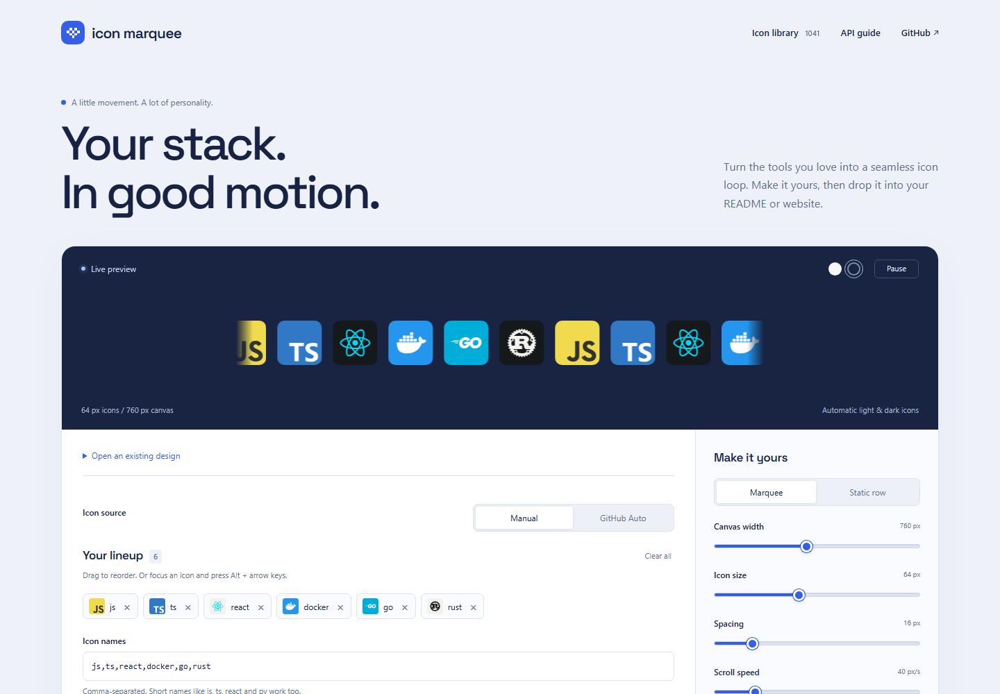

# Icon Marquee

<a href="https://github.com/IamAngusU/icon-marquee"></a>

Animated tech stacks for GitHub profiles, project READMEs and websites.

Pick from 1,041 icons, add your own logos, or let a public GitHub repo keep the lineup current. No install. No account.

Built on **[gian-gg/icon-marquee](https://github.com/gian-gg/icon-marquee)**. Icons by [skills-icons](https://github.com/syvixor/skills-icons). [Full credits](ATTRIBUTION.md).

[](https://angusu.de/icon-marquee/)

[](https://github.com/IamAngusU/icon-marquee)

<p align="center"><a href="README.de.md"></a></p>
<p align="center"><a href="docs/usage.md"></a> <a href="LICENSE"></a></p>

## Start in three steps

1. [Open the generator](https://angusu.de/icon-marquee/) and choose icons or **GitHub Auto**.
2. Adjust size, speed and effects; download the SVG or copy its live URL.
3. Paste the Markdown below into your README.

## Generator in action

[](docs/assets/generator-demo.mp4)

[Watch the short video](https://angusu.de/icon-marquee/generator-demo.mp4) · [Repository copy](docs/assets/generator-demo.mp4). Captured from the running composer; the SVG exports above animate directly in supporting README viewers.

## Paste once. Stay current.

GitHub Auto reads the languages GitHub already detects. Pin framework, database or tooling icons that language stats cannot know, then paste one live image:

[](https://angusu.de/icon-marquee/)

```md
[](https://github.com/IamAngusU/icon-marquee)
```

No workflow, token, bot commits or generated files in your repo. The hosted SVG refreshes behind a cache; appearance stays configurable in the generator.

Want a frozen asset or your own uploaded logos? Download one self-contained SVG instead:

[](https://github.com/IamAngusU/icon-marquee)

Download the SVG, commit it beside your README, paste:

```md
[](https://github.com/IamAngusU/icon-marquee)
```

One file adapts to light and dark. Optional shuffle, glint, holo and YAML presets. Your logos stay in your browser.

[Usage & effects](docs/usage.md) · [Run locally](docs/usage.md#run-and-deploy) · [Contributing](docs/conventions.md)


**Availability:** angusu.de is a best-effort service with no uptime SLA. During a
temporary GitHub failure, a running instance can serve its last successful
language result for up to seven days. An empty cache after restart, an unknown
repository or an angusu.de outage can leave a live image unavailable. A committed
SVG export works independently of the service.

## Run locally

Bun 1.4.2 or newer:

```sh
bun install --frozen-lockfile
bun run dev
```

Open `http://127.0.0.1:3000`. [Usage and deployment](docs/usage.md) · [MIT](LICENSE).
